# Selección visual actual

Generada con `python3 tools/create_selection_sheet.py` a partir de las galerías exportadas. Cada hoja muestra todas las fotografías de un álbum, con sus identificadores estables.

## Donde entra la luz — 12 fotografías

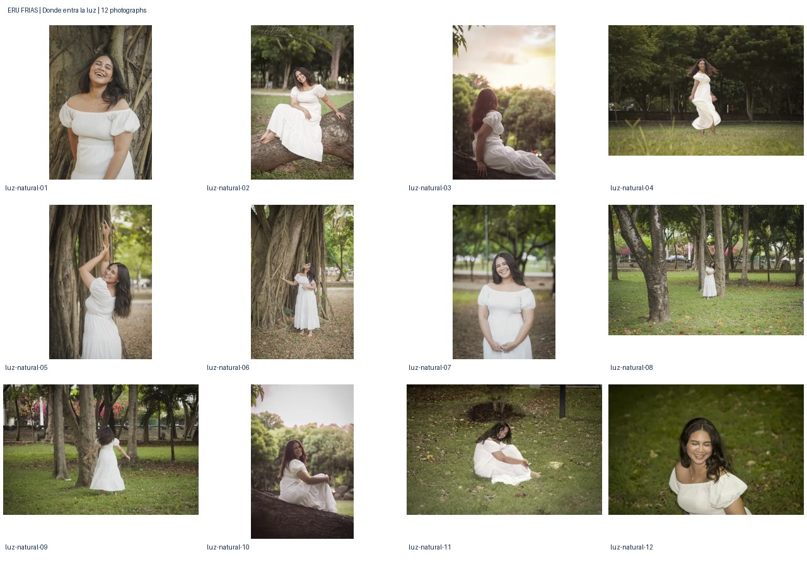

## Entre mar y cielo — 12 fotografías

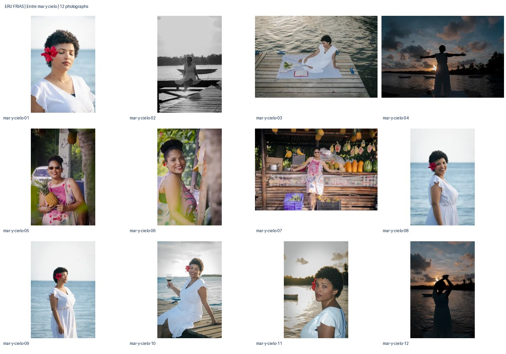

## Un estudio en azul — 10 fotografías

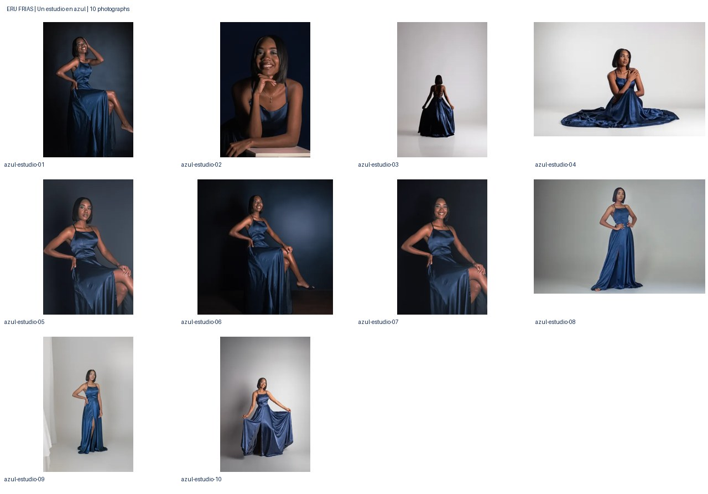

## Quince primaveras — 12 fotografías

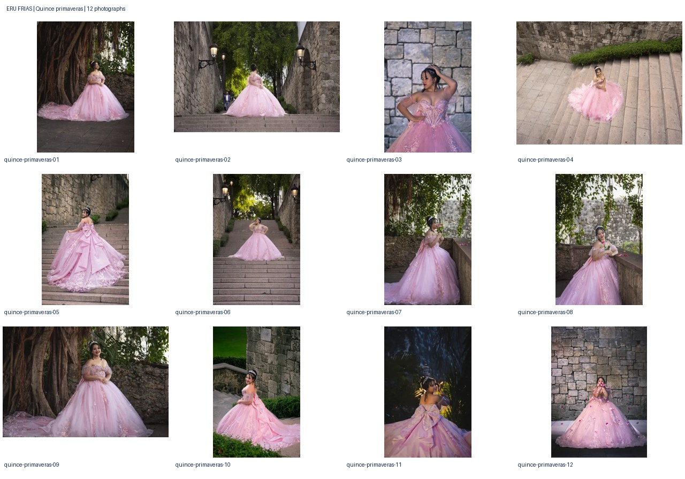

## A fuego lento — 10 fotografías

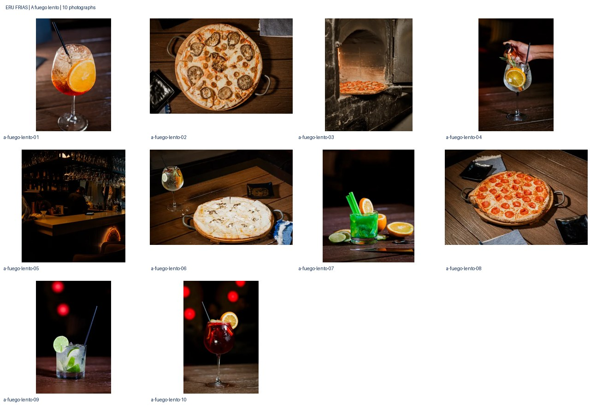

## Los primeros días — 10 fotografías

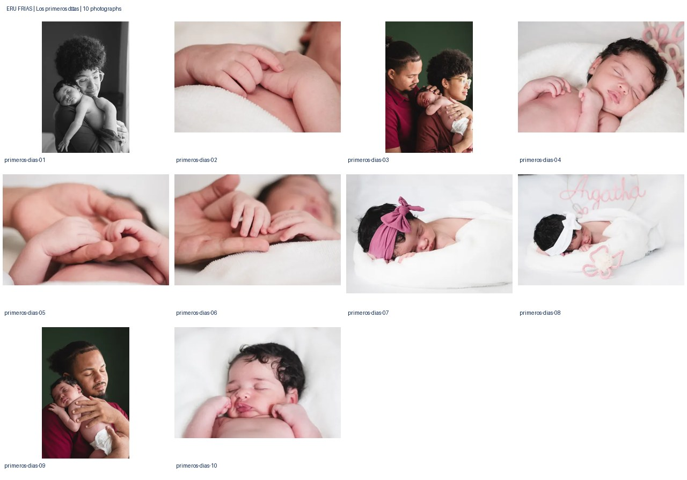

## La dulce espera — 12 fotografías

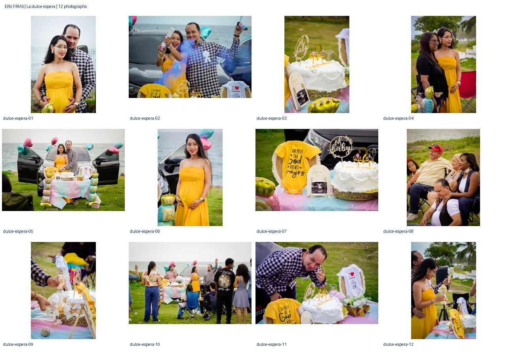

## Una pausa, un retrato — 6 fotografías

## Ideas en común — 12 fotografías

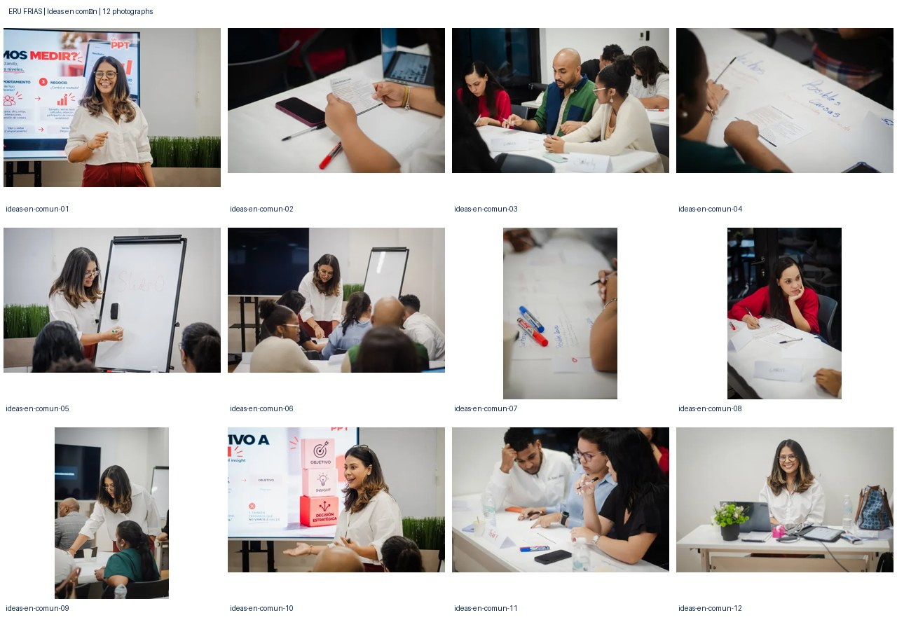

## A la orilla — 9 fotografías

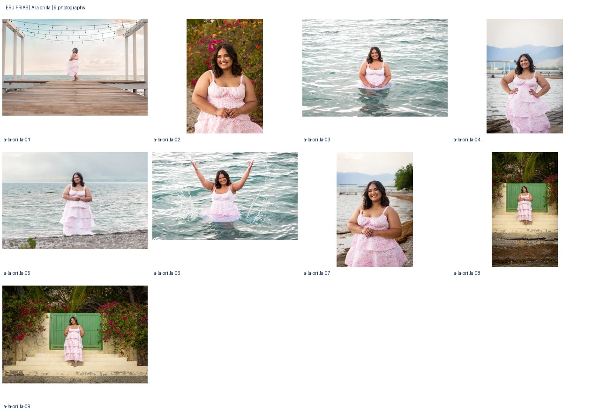

## Jardín de recuerdos — 12 fotografías

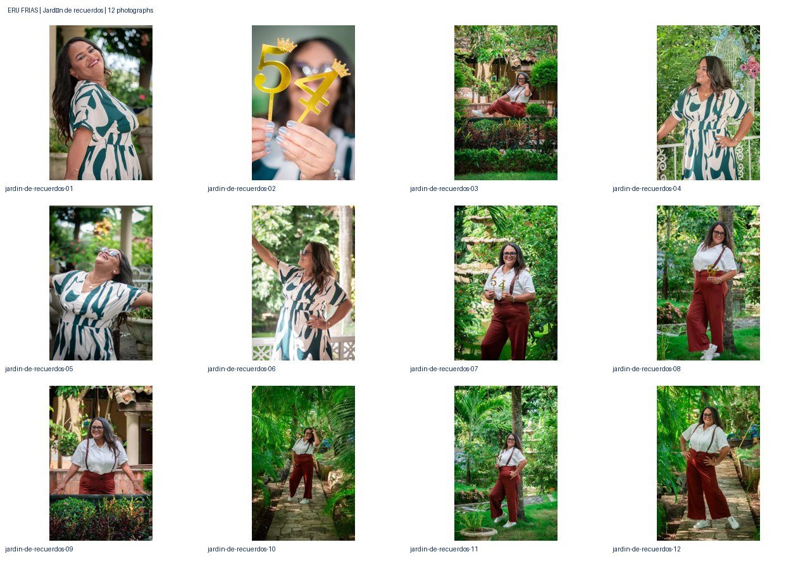

## Amarillo tropical — 8 fotografías

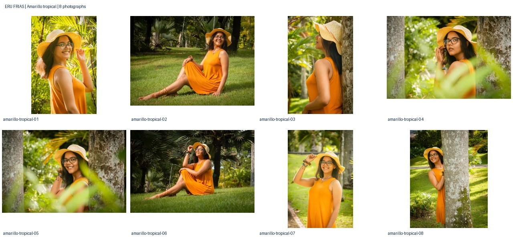

## Un día de color — 12 fotografías

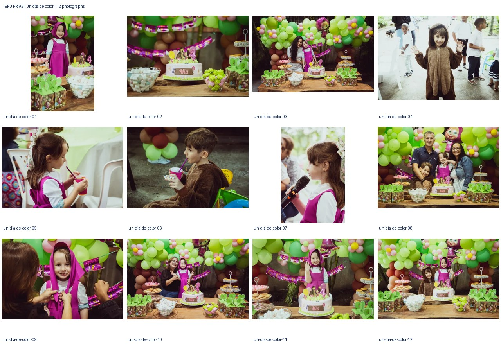

## Un nuevo capítulo — 9 fotografías

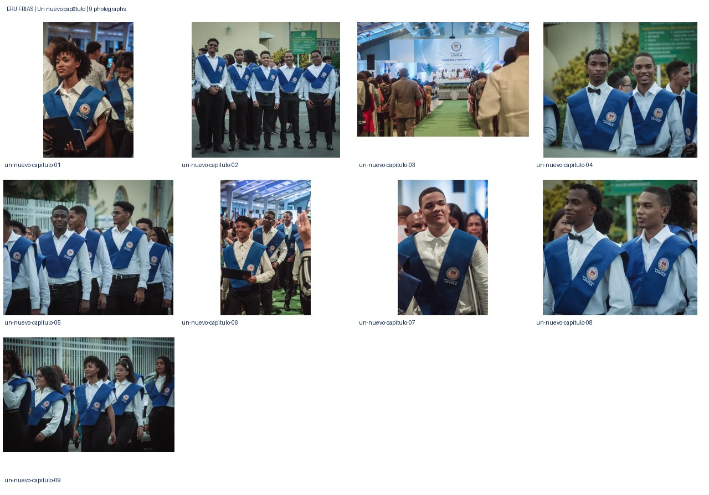

## Una noche para recordar — 12 fotografías

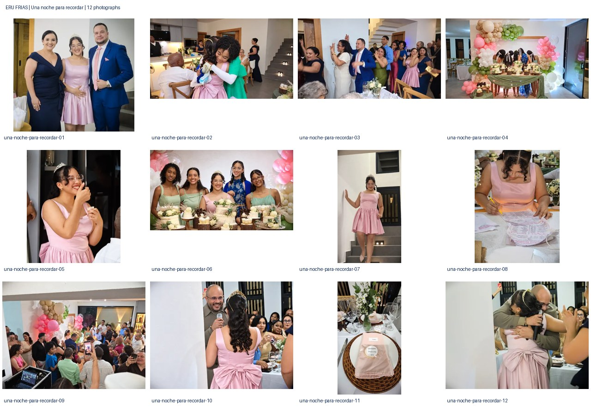
